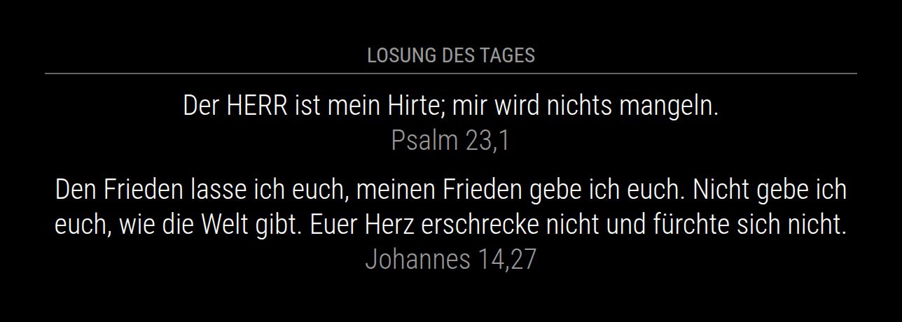

# MMM-Losung

A [MagicMirror²](https://magicmirror.builders) module that shows the Losung and the Lehrtext of the day from [Die Losungen](https://www.losungen.de), the daily Bible texts of the Herrnhuter Brüdergemeine.



The picture shows sample texts from the Lutherbibel 1912.

## Installation

The module requires MagicMirror² 2.31.0 or newer (Node.js 22 or newer). There is nothing to install with npm. Clone it into the `modules` directory of MagicMirror²:

```shell
cd ~/MagicMirror/modules
git clone https://github.com/ms-zone-41/MMM-Losung
```

Add it to your configuration, see below, and restart MagicMirror². The module downloads the texts of the year into its directory, so the user that runs MagicMirror² needs write access to it.

## Update

```shell
cd ~/MagicMirror/modules/MMM-Losung
git pull
```

Then restart MagicMirror².

If you have the module from [Dobherrmann/MMM-Losung](https://github.com/Dobherrmann/MMM-Losung), point it to this repository first. The `node_modules` directory of that version is no longer needed:

```shell
cd ~/MagicMirror/modules/MMM-Losung
git remote set-url origin https://github.com/ms-zone-41/MMM-Losung
git pull
rm -rf node_modules package-lock.json
```

Your configuration keeps working. The labels "Losung:" and "Lehrtext:" are gone, so set a `header` as in the example below, and remove `updateInterval` if you copied it from the old example.

## Configuration

Add the module to the `modules` array in `config/config.js`:

```js
	{
		module: "MMM-Losung",
		position: "top_center",
		header: "Losung des Tages",
		config: {}
	},
```

### Options

| Option | Description | Default |
| --- | --- | --- |
| `updateInterval` | How often the module checks for the texts of the day, in milliseconds. New texts appear at the latest this long after midnight. | `600000` (10 minutes) |
| `showDailyText` | Show the Losung. | `true` |
| `showTeachingText` | Show the Lehrtext. | `true` |
| `compact` | Show each reference at the end of its text, with the book in the short form of the Lutherbibel 2017, e.g. "Ps 23,1" instead of "Psalm 23,1" on a line of its own. The Lutherbibel keeps a few names whole, e.g. "1. Mose". This usually saves a line for each text. | `false` |
| `bibleFile` | The path to a Bible that you bought as an EPUB, see [Your own Bible](#your-own-bible). `~/` is your home directory. | None |

The terms of use require the Losung and the Lehrtext together, so leave both on. They do not allow changed references in publications, so use `compact` only on a mirror for yourself.

## The texts and their terms of use

Die Losungen are published by the Evangelische Brüder-Unität – Herrnhuter Brüdergemeine. It offers the texts of each year as `Losungen Free YYYY.xml` on [losungen.de/download](https://www.losungen.de/download/) for free programs, under its [terms of use](https://www.losungen.de/digital/nutzungsbedingungen): the texts and their references must not be changed, the Losung and the Lehrtext are always shown together, and only the texts of the previous, current and next year may be provided. So the file is not part of this repository, and the module gets it itself:

- If the file of the current year is missing, the module downloads it, at most once an hour. From October on, it looks once a day for the file of the next year, which the publisher puts online in autumn.
- It downloads from www.ebu.de or, if that fails, from www.brueder-unitaet.de. Both belong to the publisher and serve the same file.
- Once a day, it deletes the files of the years before the previous one.

Without internet access, download `Losung_YYYY_XML.zip` from [losungen.de/download](https://www.losungen.de/download/) yourself and put `Losungen Free YYYY.xml` from it into the module directory. The module uses it within `updateInterval`, without a restart.

## Your own Bible

With `bibleFile`, the module shows the verses of the references from a Bible of the Deutsche Bibelgesellschaft that you bought as an EPUB, instead of the texts of the Losungen:

```js
		config: {
			bibleFile: "~/bibel/basisbibel-kompakte.epub"
		}
```

- It was tested with the EPUB of "BasisBibel. Die Kompakte". If the module cannot read the file, it logs why and shows the texts of the Losungen.
- The Losungen often quote part of a verse, with an introduction such as "Paulus sprach:". The module shows the whole verses instead, without the name of the translation, so a text can begin or end in the middle of a sentence. If a verse is not in the file, the module shows the text of the Losungen for that reference.
- The e-book is licensed to you. Keep it outside the MagicMirror² directory, because MagicMirror² serves its `modules` directory over HTTP, and do not share it. The terms of use of the Losungen do not allow changed texts in publications, so use this only on a mirror for yourself.

## Troubleshooting

Instead of the texts, the module can show a message:

- **Die Losungen für YYYY fehlen.**: the file of the year is missing and could not be downloaded. The log of MagicMirror² says why. Without internet access, put the file into the module directory yourself, see [The texts and their terms of use](#the-texts-and-their-terms-of-use).
- **Die Losungen für YYYY fehlen noch.**, small and dimmed under the texts in December: the file of the next year is not online yet. The module keeps looking once a day.
- **Für heute gibt es keine Losung.**: the file has no texts for today.
- **Losung konnte nicht geladen werden.**: an unexpected error, see the log.

If the log says that a file cannot be saved, give the user that runs MagicMirror² write access to the module directory. Until then, the module keeps downloaded texts only until MagicMirror² restarts.

## Development

The tests use [node:test](https://nodejs.org/api/test.html) and the development dependencies of the module. Run them and [ESLint](https://eslint.org) in the module directory:

```shell
npm install
node --run test
node --run lint
```

GitHub runs both for every push and pull request.

## Changelog

See [CHANGELOG.md](CHANGELOG.md).

## License

ISC, see [LICENSE](LICENSE). [Dobherrmann](https://github.com/Dobherrmann/MMM-Losung) wrote the module, which this fork continues.
